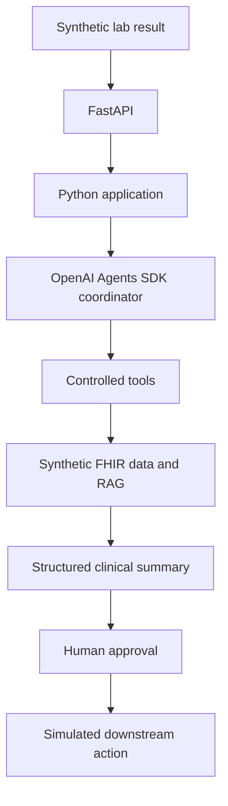

# Planned architecture

All patient and lab data must be synthetic. The following flow is a long-term
design. The current implementation covers typed synthetic data, deterministic
Python retrieval, and a single coordinator agent invoked from a CLI.



The Python application will own workflow rules and typed inputs and outputs.
The coordinator will request capabilities through explicitly allowed tools.
FHIR and retrieval adapters will provide synthetic context. A structured summary
will separate findings, supporting evidence, and proposed actions. A human must
approve a proposed action before a simulated downstream action can occur.

## Current boundaries

- `config.py`: environment-based Pydantic settings.
- `models/patient.py`: typed patient records, summaries, and dataset validation.
- `data_loader.py`: file reading and Pydantic parsing, configured by `IDA_DATA_DIR`.
- `services/patients.py`: patient ID validation, lookup, filtering, and typed returns.
- `__main__.py`: a local CLI that prints the service summary as JSON.
- `tools/patient_tools.py`: five SDK function tools scoped to the selected patient.
- `agent.py`: one coordinator, safety instructions, model configuration, and SDK invocation.
- `agent_demo.py`: agent CLI with local tool-usage logging and one final response.
- `data/patients.json`: five synthetic patients with a fixed reference date.
- `tests/`: deterministic tests plus mocked agent, tool, configuration, and CLI tests.

The loader reads and validates a complete dataset without performing clinical
retrieval. The service layer selects a patient and returns a summary; specialized
getters select typed sections of the same summary. The CLI formats the result.
This keeps file parsing outside retrieval logic without adding repository or
adapter interfaces.

The current agent flow is:

```text
CLI patient ID + microbiology notification
  -> one OpenAI Agents SDK coordinator
  -> selected read-only function tools
  -> existing deterministic Python services
  -> validated synthetic JSON fixtures
  -> tool results returned to the coordinator
  -> one decision-support response for human clinician review
```

The model sees tool schemas and only the records returned by requested tools.
Patient selection is injected through local SDK context, not model-generated
arguments. The services and loader import no agent framework code. The SDK runner
handles tool dispatch and continuation; Python enforces patient scope, a turn
limit, failure propagation, and the fixed human-review notice. Clinical behavior
and source citation are specified in the agent instructions and still need human
verification. No diagnosis, prescribing, record mutation, or downstream action
capability is exposed.

Only the agent demo makes OpenAI API calls. It disables SDK tracing and request
response storage and does not create a persistent session. FHIR, PostgreSQL, RAG,
FastAPI, multiple agents, a frontend, and an approval/action workflow remain
future work. This milestone presents information for review without implementing
an approval mechanism or simulated downstream action.
