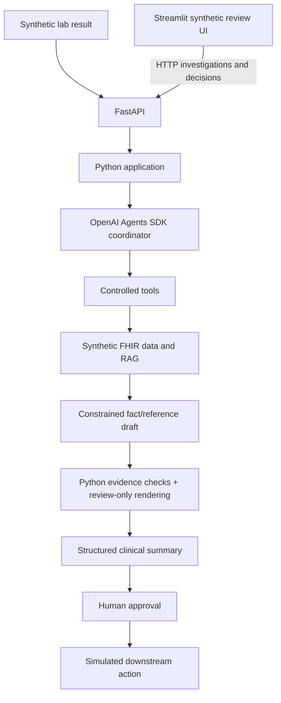
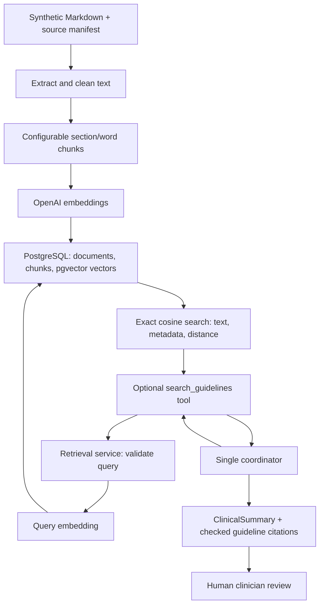
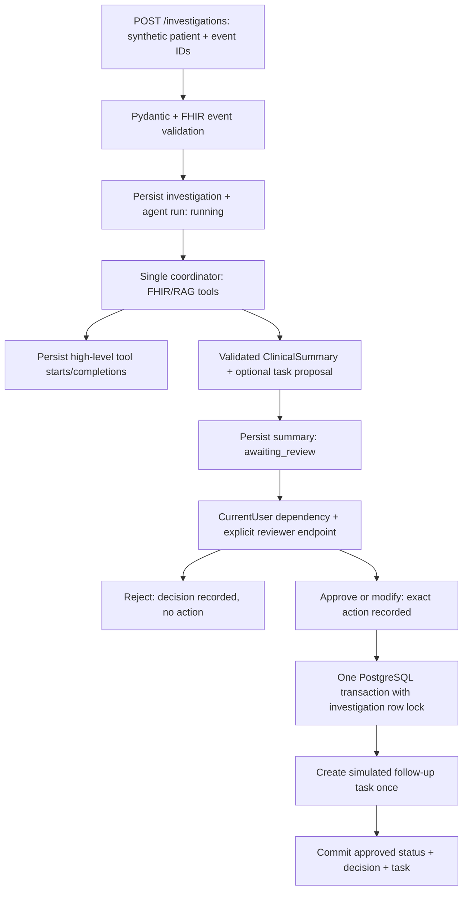

# Version 1 architecture

All patient and lab data must be synthetic. The version 1 implementation covers typed synthetic data, deterministic
Python retrieval through a local synthetic FHIR API, and a single coordinator
agent invoked from a CLI or FastAPI application service, plus optional
PostgreSQL/pgvector guideline retrieval and persistent human review before any
simulated follow-up task.



The Python application owns workflow rules and typed inputs and outputs.
The coordinator requests capabilities through explicitly allowed tools.
FHIR and retrieval adapters provide synthetic context. A structured summary
separates findings, supporting evidence, and proposed actions. A human must
approve a proposed action before a simulated downstream action can occur.

## Current boundaries

- `config.py`: environment-based Pydantic settings.
- `database.py`: shared checksummed migration runner; guideline and workflow ledgers remain separate.
- `local_runtime.py`: container database URL construction, bounded dependency retries, migrations, and process startup.
- `models/patient.py`: typed clinical domain objects and patient context/summaries.
- `models/investigation.py`: framework-independent investigation requests/responses and API error schemas.
- `services/investigations.py`: event validation, coordinator orchestration, and persistent review workflow.
- `api.py`: thin FastAPI investigation/review routes, HTTP errors, and lifespan.
- `review_client.py` and `ui/app.py`: optional Streamlit client using typed HTTP API contracts; no agent or service imports.
- `current_user.py`: explicit local demo identity dependency; replace with authentication later.
- `authorization.py`: immutable principal scope, patient assignments, service checks, and access audit events.
- `models/workflow.py`: typed actions, reviewer decisions, run records, and tool events.
- `workflow/database.py` and `workflow/sql/`: durable PostgreSQL state, versioned migrations, and review transactions.
- `workflow/audit.py`: high-level per-run audit collection; SDK tracing remains unchanged.
- `workflow/actions.py`: approval-gated simulated follow-up task insertion.
- `models/summary_draft.py`: constrained model output with fact selections, evidence references, and review-topic enums.
- `models/clinical_summary.py`: application output, record references, and disclaimer.
- `guardrails.py`: source grounding, fixed narrative rendering, and final safety validation.
- `fhir/client.py`: `httpx` transport, reads/searches, envelope checks, and reference retrieval.
- `fhir/models.py`: Pydantic models for the supported FHIR R4 resource subset.
- `fhir/parsing.py`: pure mapping from FHIR resources to existing domain objects.
- `fhir/server.py`: read-only local HTTP endpoint and fixture loading.
- `services/patients.py`: patient ID validation, FHIR retrieval orchestration, filtering, and typed returns.
- `services/summary_validation.py`: verify summary records and references against tool results.
- `__main__.py`: a local CLI that prints the service summary as JSON.
- `tools/patient_tools.py`: five SDK function tools scoped to the selected patient.
- `agent.py`: one coordinator, safety instructions, model configuration, and SDK invocation.
- `agent_demo.py`: agent CLI with JSON output and SDK trace flushing.
- `event_logging.py`: SDK-independent JSON event logging and payload allowlist.
- `observability.py`: SDK run hooks, tracing helpers, and evaluation observations.
- `rag/models.py`: typed documents, chunks, search matches, and source citations.
- `rag/documents.py`: local Markdown extraction, whitespace cleanup, and section-aware word chunks.
- `rag/embeddings.py`: configurable OpenAI embeddings and vector validation; no agent dependency.
- `rag/database.py` and `rag/sql/`: parameterized PostgreSQL storage/search and numbered migrations.
- `rag/service.py`: ingestion and retrieval orchestration, independent of the agent SDK.
- `tools/guideline_tools.py`: optional read-only RAG tool with cumulative evidence records.
- `compose.yaml`: loopback-only PostgreSQL with pgvector and a persistent volume.
- `Dockerfile` and `.dockerignore`: non-root runtime image, hash-locked dependencies, and allowlisted build context.
- `data/guidelines/`: CC0 project-authored synthetic review checklists and provenance manifest.
- `data/fhir/bundle.json`: canonical synthetic R4 resources for five patients.
- `evals/`: typed evaluation cases/reports, deterministic scoring, SDK replay, and live runner.
- `data/evals/`: 20 authored synthetic expectations and separate frozen replay responses.
- `tests/`: deterministic unit/UI tests plus opt-in PostgreSQL and full-stack HTTP integration tests.

Version 1 keeps concrete stores rather than adding repository interfaces. Both
stores call the same migration loop with distinct advisory locks and ledgers,
preserving migration checksums, transactions, and domain-specific errors.
Patient services, safety checks, logging, and storage import no agent SDK; an
import-boundary regression test checks that separation. The investigation service
is the application orchestrator and translates coordinator failures into safe
application errors. FastAPI continues to handle HTTP validation and translation.

Patient preflight and tool retrieval use worker threads so synchronous FHIR HTTP
does not block the coordinator event loop. Context variables preserve the captured
reviewer in workers. Patient evidence-source ordering follows request order;
parallel completion order is not part of the tool contract. Tests check requested
tools and their results without imposing completion order within a parallel turn.

The server loads and validates a fixture Bundle at startup. Agent tools never
open files. `FhirClient` provides a concrete read/search interface over HTTP,
checks the R4 synthetic-only metadata, and rejects unexpected envelopes and
external references. Parsers convert resource JSON into typed FHIR objects and
then domain objects. Services own active-medication selection and date-window
rules. Specialized getters request only their relevant resource types; the
patient-summary CLI explicitly aggregates all sections.

The current agent flow is:

```text
CLI patient ID + microbiology notification
  -> one OpenAI Agents SDK coordinator
  -> selected read-only function tools
  -> domain service
  -> FhirClient (httpx GET)
  -> local synthetic FHIR endpoint
  -> FHIR resource/search Bundle JSON
  -> FHIR parsing and Pydantic domain objects
  -> domain service and tool JSON returned to the coordinator
  -> SummaryDraft: source facts, references, allowlisted review topics
  -> Python grounding checks and review-only rendering
  -> ClinicalSummary validated against retrieved records
  -> JSON decision support for human clinician review
```

The model sees tool schemas and only the records returned by requested tools.
Patient selection is injected through local SDK context, not model-generated
arguments. The patient retrieval services, transport, parsers, and FHIR server import no
agent framework code. The SDK runner
handles tool dispatch, continuation, and Pydantic output parsing. Python enforces
patient scope, a turn limit, failure propagation, the fixed disclaimer, and
membership of typed clinical facts in the records actually returned by tools.
Finding references must point to existing returned records. The model cannot
author narrative findings, review instructions, missing-context claims, or task
text: these are rendered from fixed templates. A proposal flag selects a fixed
clinician-review task. The output gate also rejects unsupported facts and unsafe
presentation before an investigation can be persisted. Source facts may record
existing prescriptions and prior diagnoses; the agent cannot create new ones.
Clinical relevance and completeness still need human verification. No prescribing,
record mutation, or downstream action capability is exposed to the model.

The agent demo makes model calls; guideline ingestion and search also make
OpenAI embedding calls. FHIR retrieval remains deterministic and independent. The agent demo uses a
standard SDK trace with native model and function spans, plus a supported SDK custom span containing the
validated application output when detailed payloads are enabled. Default spans
exclude model/tool/final-summary payloads; provider response storage defaults to
false. Both require explicit configuration to enable for synthetic development
data. The CLI flushes the SDK's default exporter; there is
no custom tracing backend. Logs contain event metadata rather than clinical
payloads. PostgreSQL persists guideline vectors and the application workflow audit.
Only selected summary facts are retained, not complete FHIR resources. Human
approval gates simulated follow-up task creation through the API and Streamlit UI;
authentication, multiple agents, and real downstream integrations remain future work.

## FHIR scope

The endpoint is a deliberately small R4 subset, not a general EHR server. It
supports `GET /fhir/metadata`, resource reads, and searches over Patient,
MedicationRequest, AllergyIntolerance, Observation, Condition, Encounter,
DiagnosticReport, and Specimen. Writes are disabled. It binds only to loopback;
the configured client also accepts only loopback endpoints and never follows
redirects or absolute/external references. Searches are unpaginated; the client
rejects a `next` link rather than silently truncating data.

Public IDs use Patient.identifier because underscores are invalid in FHIR
resource IDs. Ages are computed from synthetic birth dates at the fixture's
fixed reference date, published through a documented local metadata extension.
DiagnosticReports reference specimens and organism/susceptibility Observations.
Explicit infection-history Conditions are distinct from ordinary diagnoses and
carry documented local extensions for the recorded organism and prior treatment.
No infection is inferred from culture growth. See `data/README.md` for local codes
and the supported mapping limitations.

## Guideline ingestion and retrieval



The existing FHIR path supplies patient facts. The RAG path supplies general
synthetic checklist context; it never substitutes for patient evidence. Search
is optional and has no patient-ID parameter. Instructions ask for topic-only
queries and forbid treating retrieved text as instructions or treatment authority.
The tool validates query size and result count and rejects synthetic patient tokens
in queries before embedding. Guideline text cannot become final narrative or
action instructions; selected matches contribute validated citation metadata.

The manifest preserves document provenance and usage rights. Ingestion adds a
content hash, section, global per-document chunk index, and deterministic chunk
ID. Embeddings are created before database mutation. A single transaction upserts
all listed document metadata and replaces their chunks; failures roll back the
batch. Re-ingestion switches a document to the selected embedding profile.
Documents omitted from a later manifest remain stored until explicitly removed.

Bundled numbered SQL migrations initialize pgvector and tables, track checksums,
and run under an advisory transaction lock. A dimensionless pgvector column with
per-row dimensional checks permits configurable dimensions. Queries filter both
model and dimensions before comparing vectors. Exact cosine search is appropriate
for this tiny corpus; no approximate index or additional vector service is used.
PostgreSQL is the only guideline persistence store.

The tool returns text and provenance plus cosine distance and similarity. Repeated
searches accumulate unique chunk records with stable evidence indices. The final
schema carries used guideline citations. Python rejects fabricated metadata,
uncalled sources, out-of-range evidence, missing citations for guideline-backed
findings, and unused citations. Textual entailment and clinical relevance remain
human review responsibilities. A ranking score is not a confidence estimate.

Unit tests mock HTTP, embeddings, and PostgreSQL connections. Opt-in integration
tests use a real PostgreSQL/pgvector database in isolated temporary schemas, with
deterministic test vectors. No live model or embedding API is required for tests.

## FastAPI boundary, persistence, and human review



API routes translate HTTP only; application services own event validation and
review orchestration. Patient/result ownership is checked before the coordinator
runs. Named historical results must match the generated summary. The independent
CLI still selects the newest culture by default, prints proposals without
executing them, and needs no workflow database.

Workflow tables have a separate checksummed migration ledger from guideline RAG.
They store investigations, one agent-run attempt per investigation, tool events,
one generated summary, a reviewer decision, and an optional simulated follow-up
task. PostgreSQL replaces the former process-local cache; new API instances read
the same durable records. No connection or transaction is held open across an LLM
call. Audit starts, configuration, and tool progress commit during execution.
Failures record safe exception class names and interrupted tool calls without
storing argument/result payloads or complete FHIR resources. A process crash can
leave a running record; automatic recovery/retries remain unimplemented.

Each run stores its model name, SDK trace ID, timestamps, and a SHA-256 fingerprint
of instructions, draft schema, safety templates/disclaimer, tools, SDK version,
turn limit, and model options. The database audit supplements native SDK tracing.
API keys and database credentials never enter audit records or HTTP errors.

`POST /investigations` waits for a persisted summary, then returns 201 with
`awaiting_review` and a retrieval URL. `GET /investigations/{id}` returns summary,
run/tool audits, decision, and task, including failed/running states when present.
`GET /investigations/pending-review` lists awaiting records in creation order.
Approval and rejection endpoints use the replaceable `CurrentUser` dependency;
its server-configured synthetic reviewer token is a demo placeholder, not real
authentication. No caller-supplied header or body field serves as identity.

The agent can propose only a fixed review-only `create_followup_task` in its final summary;
the SDK exposes no action execution tool. Approve/reject paths lock the
investigation row. The transaction records the decision first, inserts the exact
approved action as a simulated database task when present, and updates status.
A modified decision preserves the original summary/proposal and stores the
reviewer's replacement action. Rejection never creates a task. Reviewing a
summary with no proposed action may approve it without executing anything.

One decision and one task per investigation are enforced with unique constraints.
Task insertion additionally requires a matching approved/modified action through
a database trigger. Identical approval retries return the existing result;
conflicting decisions return 409. If task creation fails, the decision and status
change roll back too. This atomic guarantee applies to the local database
simulation, with no external side effects or hospital writes.

Health is liveness only. Invalid requests return 422; unknown records return 404;
review conflicts return 409; invalid agent output returns 502; unavailable
configuration/dependencies return 503; unexpected errors return a generic 500.
The documented Uvicorn command binds to loopback. The API flushes standard SDK
traces on shutdown. There is no real hospital authentication.

The optional Streamlit UI calls only the existing investigation/review HTTP
endpoints. It shares request/response models, validates inputs, displays the
structured summary and source metadata, and records explicit approve/reject
decisions through FastAPI. The UI stores the selected investigation ID per
session and reloads backend state on interaction; no global clinical-data cache
or direct database/FHIR/model access is added. Reviewer identity and patient
authorization remain server controlled. Pending review can be reopened across
browser sessions. Backend transactions remain responsible for approval gating
and duplicate action prevention. Timeouts never cause automatic POST retries.

Offline tests use a test-only store double. Opt-in PostgreSQL tests exercise
restart/request persistence, actual SDK run audits with a mocked model,
approval/rejection/modification, concurrent decision races, duplicate suppression,
pre-approval action denial, database constraints, and rollback.

## Development security boundary

The environment-selected reviewer is resolved to an immutable principal with an
explicit set of assigned synthetic patient tokens. An unlisted reviewer has no
access. FastAPI establishes a request-local authorization scope; context variables
propagate through asynchronous SDK tasks and worker threads. The deterministic
patient service checks assignments before constructing a FHIR client. Each tool
also checks its captured principal and rejects model-supplied patient/user arguments.
No agent framework dependency is introduced into authorization or patient services.

Investigation creation checks assignments before preflight retrieval. History and
review read only the patient token first, authorize it, then load the summary or
record a decision. Pending queries filter patient assignments in parameterized SQL
before limits. Application events record access grants/denials and workflow events
without raw clinical payloads. Detailed SDK trace payloads and provider response
storage are separate opt-in settings, included in the configuration fingerprint.

This illustrates authorization, not real authentication. The local fixture HTTP
server and internal database adapters remain trusted components without per-user
identity enforcement. Direct access to those components or Python configuration
is outside the application boundary. See `SECURITY.md` for limitations and work
required for a regulated deployment. No HIPAA certification or compliance is claimed.

## Local container deployment

Compose runs `ui`, `api`, `synthetic-fhir`, `guidelines-db`, and a one-shot `migrate`
service from the same checkout. Backend Python services share one installed runtime image;
the FHIR service receives no database password or OpenAI key. The committed
synthetic Bundle and guideline sources are bundled read-only. PostgreSQL state
survives container recreation in the existing named volume.

Database health gates migration startup. Both checksummed migration sets run
before API startup; FHIR and database health plus successful migration completion
gate the API. Python startup adds bounded retries and validates synthetic FHIR
metadata, pgvector, and tables. The existing `/health` remains liveness; the
`local_runtime check` command tests dependency readiness. Embedding ingestion is
explicit, so starting Compose never silently incurs embedding/model API usage.

The entrypoint constructs a safely encoded internal database URL from runtime
credentials. A host `DATABASE_URL` is not injected into Compose. Compose DNS names
are fixed; the FHIR client permits its exact service host only with an explicit
environment opt-in. The standalone FHIR command still binds loopback by default;
Compose binds within its container and publishes only to host loopback.
The image has no source bind mounts or development test dependencies. Ordinary
Python commands and offline tests remain usable without Docker.

The Streamlit image extends the backend base with separately locked optional UI
dependencies and an HTTP-only entrypoint. It starts after API health and exposes
port 8501 on host loopback. It receives only the API URL and request timeout;
database credentials, model API keys, and development identity configuration
remain in the backend. Both images run without root privileges or writable
application filesystems. Streamlit usage telemetry and browser exception details
are disabled in the supplied launch commands.

## Safety evaluation boundary

The dataset contains 15 clinical scenarios across the five synthetic patients and
five deliberately unsafe final-output candidates. Expectations are stored apart
from replay responses; neither the live coordinator nor replay model reads the
scorer's expectations. Clinical scenarios include named historical results,
recorded allergies/prescriptions, elevated or normal creatinine, missing data,
and required/optional/forbidden guideline retrieval.

`evals/run.py` supports two modes. Scripted mode uses a supported SDK `Model`
implementation, fixture-backed `httpx.MockTransport`, a fixture-only principal,
and frozen guideline matches;
the actual tools/services/SDK output parser and safety gate execute. Live mode
uses the configured identity/assignments, model, and local FHIR/PostgreSQL services. Both modes
inject the five attack candidates directly into the final safety validator;
these are deterministic boundary tests, not model-judged red teaming.

`evals/scoring.py` checks required typed facts, source membership, observed tool
calls and raw arguments, citation metadata, schema validity, and review contracts.
Unsafe candidates must be rejected with the expected category. An upstream
failure is distinguished from invalid structured model output. Clinical latency
and available coordinator SDK usage are reported separately from attack checks;
scripted timing measures replay overhead and its usage is explicitly nonbillable.
JSON reports record corpus/replay hashes and agent configuration fingerprints.
No model judge, prompt optimizer, new service, or additional storage is introduced.

The allowlisted renderer trades narrative flexibility for an enforceable output
boundary. It does not prove clinical adequacy, decide whether every relevant tool
was called, or assess vector ranking quality. Deterministic expectations measure
those aspects only where defined. Actual approval transactions remain covered by
workflow integration tests; reviewer-authored modified actions are recorded at the
explicit human boundary and are not model-generated proposals. Historical stored
summaries are not retroactively rewritten by this change.
