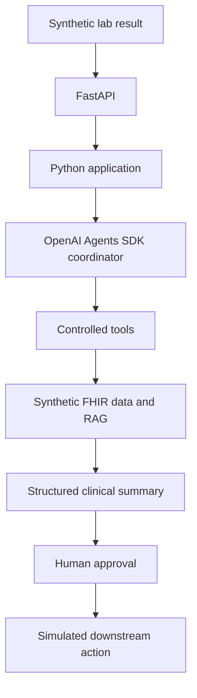

# Planned architecture

All patient and lab data must be synthetic. The following flow is a long-term
design; this milestone implements only project setup and configuration.

The Python application will own workflow rules and typed inputs and outputs.
The coordinator will request capabilities through explicitly allowed tools.
FHIR and retrieval adapters will provide synthetic context. A structured summary
will separate findings, supporting evidence, and proposed actions. A human must
approve a proposed action before a simulated downstream action can occur.

## Current boundaries

- `config.py`: environment-based Pydantic settings.
- `models/`: reserved for typed data contracts in the next milestone.
- `services/`: reserved for application workflow logic.
- `tools/`: reserved for controlled tool implementations.
- `data/`: synthetic fixtures only; no real PHI or credentials.
- `tests/`: package import smoke test.

There are no external integrations, clinical decisions, network calls, persistent
stores, or downstream actions implemented in this milestone. Add concrete modules
as features require them; no coordinator or adapter interfaces are needed yet.
