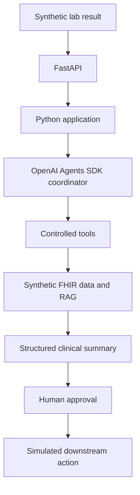

# Planned architecture

All patient and lab data must be synthetic. The following flow is a long-term
design. The current implementation covers typed synthetic data, loading, and
deterministic Python retrieval only.

The Python application will own workflow rules and typed inputs and outputs.
The coordinator will request capabilities through explicitly allowed tools.
FHIR and retrieval adapters will provide synthetic context. A structured summary
will separate findings, supporting evidence, and proposed actions. A human must
approve a proposed action before a simulated downstream action can occur.

## Current boundaries

- `config.py`: environment-based Pydantic settings.
- `models/patient.py`: typed patient records, summaries, and dataset validation.
- `data_loader.py`: file reading and Pydantic parsing, configured by `IDA_DATA_DIR`.
- `services/patients.py`: patient ID validation, lookup, filtering, and typed returns.
- `__main__.py`: a local CLI that prints the service summary as JSON.
- `tools/`: reserved for controlled tool implementations.
- `data/patients.json`: five synthetic patients with a fixed reference date.
- `tests/`: import smoke test and service, loading, and CLI tests.

The loader reads and validates a complete dataset without performing clinical
retrieval. The service layer selects a patient and returns a summary; specialized
getters select typed sections of the same summary. The CLI formats the result.
This keeps file parsing outside retrieval logic without adding repository or
adapter interfaces.

There are no external integrations, clinical decisions, network calls, databases,
or downstream actions implemented in this milestone. Human approval and all other
agent workflow components in the diagram remain future work.
