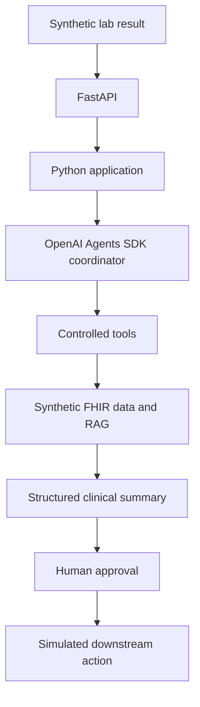

# Planned architecture

All patient and lab data must be synthetic. The following flow is a long-term
design. The current implementation covers typed synthetic data, deterministic
Python retrieval through a local synthetic FHIR API, and a single coordinator
agent invoked from a CLI.



The Python application will own workflow rules and typed inputs and outputs.
The coordinator will request capabilities through explicitly allowed tools.
FHIR and retrieval adapters will provide synthetic context. A structured summary
will separate findings, supporting evidence, and proposed actions. A human must
approve a proposed action before a simulated downstream action can occur.

## Current boundaries

- `config.py`: environment-based Pydantic settings.
- `models/patient.py`: typed clinical domain objects and patient context/summaries.
- `models/clinical_summary.py`: structured agent output, record references, and disclaimer.
- `fhir/client.py`: `httpx` transport, reads/searches, envelope checks, and reference retrieval.
- `fhir/models.py`: Pydantic models for the supported FHIR R4 resource subset.
- `fhir/parsing.py`: pure mapping from FHIR resources to existing domain objects.
- `fhir/server.py`: read-only local HTTP endpoint and fixture loading.
- `services/patients.py`: patient ID validation, FHIR retrieval orchestration, filtering, and typed returns.
- `services/summary_validation.py`: verify summary records and references against tool results.
- `__main__.py`: a local CLI that prints the service summary as JSON.
- `tools/patient_tools.py`: five SDK function tools scoped to the selected patient.
- `agent.py`: one coordinator, safety instructions, model configuration, and SDK invocation.
- `agent_demo.py`: agent CLI with JSON output and SDK trace flushing.
- `observability.py`: high-level JSON event logging and SDK run hooks.
- `data/fhir/bundle.json`: canonical synthetic R4 resources for five patients.
- `tests/`: deterministic tests plus mocked agent, tool, configuration, and CLI tests.

The server loads and validates a fixture Bundle at startup. Agent tools never
open files. `FhirClient` provides a concrete read/search interface over HTTP,
checks the R4 synthetic-only metadata, and rejects unexpected envelopes and
external references. Parsers convert resource JSON into typed FHIR objects and
then domain objects. Services own active-medication selection and date-window
rules. Specialized getters request only their relevant resource types; the
patient-summary CLI explicitly aggregates all sections.

The current agent flow is:

```text
CLI patient ID + microbiology notification
  -> one OpenAI Agents SDK coordinator
  -> selected read-only function tools
  -> domain service
  -> FhirClient (httpx GET)
  -> local synthetic FHIR endpoint
  -> FHIR resource/search Bundle JSON
  -> FHIR parsing and Pydantic domain objects
  -> domain service and tool JSON returned to the coordinator
  -> ClinicalSummary validated against retrieved records
  -> JSON decision support for human clinician review
```

The model sees tool schemas and only the records returned by requested tools.
Patient selection is injected through local SDK context, not model-generated
arguments. The services, transport, parsers, and FHIR server import no agent framework code. The SDK runner
handles tool dispatch, continuation, and Pydantic output parsing. Python enforces
patient scope, a turn limit, failure propagation, the fixed disclaimer, and
membership of typed clinical facts in the records actually returned by tools.
Finding references must point to existing returned records. Free-text meaning
and clinical appropriateness still need human verification. No prescribing,
record mutation, or downstream action capability is exposed.

Only the agent demo makes OpenAI API calls. It uses a standard SDK trace with
native model and function spans, plus a supported SDK custom span containing the
validated output. Detailed trace payloads and response storage are enabled for
synthetic development data. The CLI flushes the SDK's default exporter; there is
no custom tracing backend. Logs contain event metadata rather than clinical
payloads. No application database or persistent session is added. PostgreSQL, RAG,
FastAPI, multiple agents, a frontend, and an approval/action workflow remain
future work. This milestone presents information for review without implementing
an approval mechanism or simulated downstream action.

## FHIR scope

The endpoint is a deliberately small R4 subset, not a general EHR server. It
supports `GET /fhir/metadata`, resource reads, and searches over Patient,
MedicationRequest, AllergyIntolerance, Observation, Condition, Encounter,
DiagnosticReport, and Specimen. Writes are disabled. It binds only to loopback;
the configured client also accepts only loopback endpoints and never follows
redirects or absolute/external references. Searches are unpaginated; the client
rejects a `next` link rather than silently truncating data.

Public IDs use Patient.identifier because underscores are invalid in FHIR
resource IDs. Ages are computed from synthetic birth dates at the fixture's
fixed reference date, published through a documented local metadata extension.
DiagnosticReports reference specimens and organism/susceptibility Observations.
Explicit infection-history Conditions are distinct from ordinary diagnoses and
carry documented local extensions for the recorded organism and prior treatment.
No infection is inferred from culture growth. See `data/README.md` for local codes
and the supported mapping limitations.
