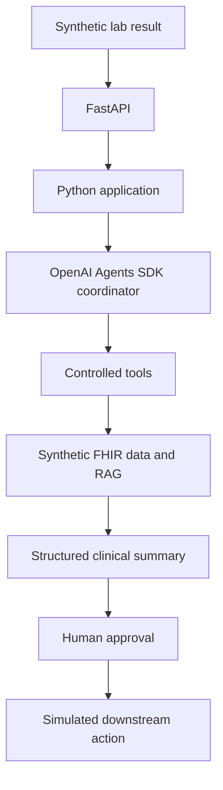
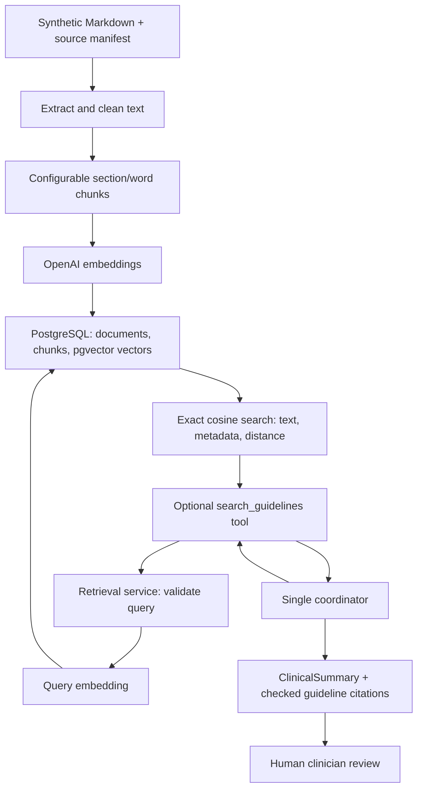
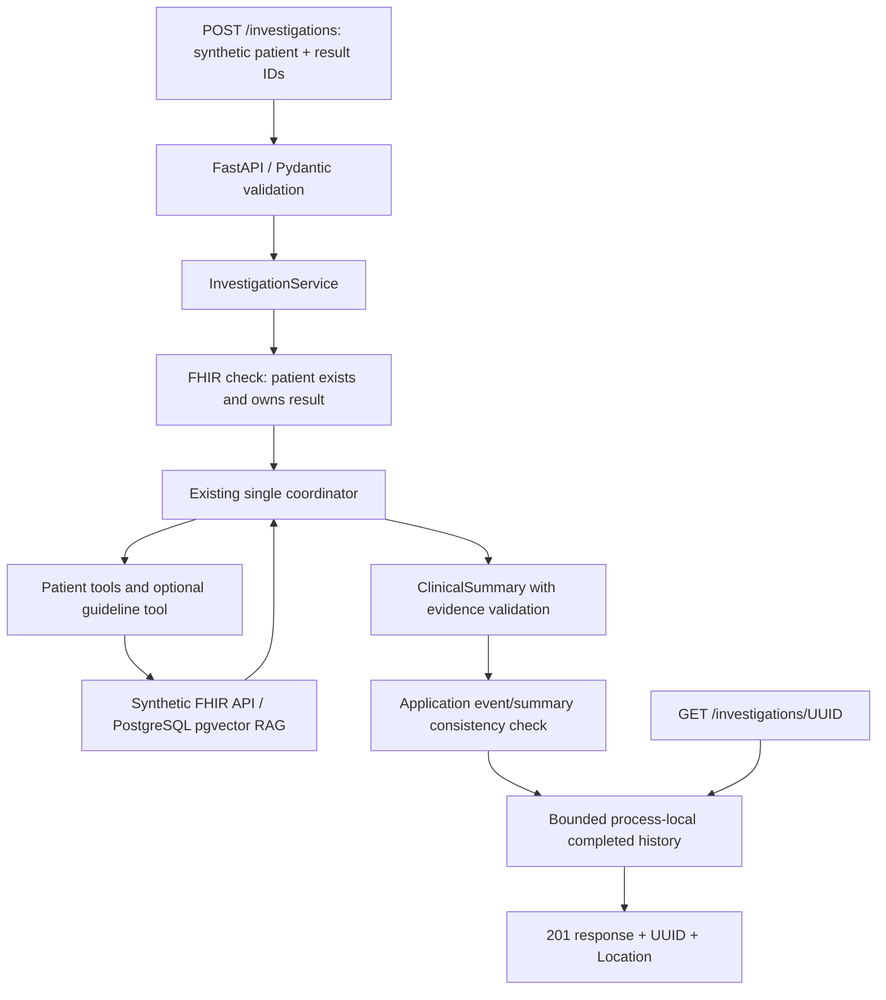

# Planned architecture

All patient and lab data must be synthetic. The following flow is a long-term
design. The current implementation covers typed synthetic data, deterministic
Python retrieval through a local synthetic FHIR API, and a single coordinator
agent invoked from a CLI or FastAPI application service, plus optional
PostgreSQL/pgvector guideline retrieval.



The Python application owns workflow rules and typed inputs and outputs.
The coordinator will request capabilities through explicitly allowed tools.
FHIR and retrieval adapters will provide synthetic context. A structured summary
will separate findings, supporting evidence, and proposed actions. A human must
approve a proposed action before a simulated downstream action can occur.

## Current boundaries

- `config.py`: environment-based Pydantic settings.
- `models/patient.py`: typed clinical domain objects and patient context/summaries.
- `models/investigation.py`: framework-independent investigation requests/responses and API error schemas.
- `services/investigations.py`: event validation, coordinator orchestration, and bounded completed-result history.
- `api.py`: thin FastAPI routes, application-service dependency, HTTP error handling, and lifespan.
- `models/clinical_summary.py`: structured agent output, record references, and disclaimer.
- `fhir/client.py`: `httpx` transport, reads/searches, envelope checks, and reference retrieval.
- `fhir/models.py`: Pydantic models for the supported FHIR R4 resource subset.
- `fhir/parsing.py`: pure mapping from FHIR resources to existing domain objects.
- `fhir/server.py`: read-only local HTTP endpoint and fixture loading.
- `services/patients.py`: patient ID validation, FHIR retrieval orchestration, filtering, and typed returns.
- `services/summary_validation.py`: verify summary records and references against tool results.
- `__main__.py`: a local CLI that prints the service summary as JSON.
- `tools/patient_tools.py`: five SDK function tools scoped to the selected patient.
- `agent.py`: one coordinator, safety instructions, model configuration, and SDK invocation.
- `agent_demo.py`: agent CLI with JSON output and SDK trace flushing.
- `observability.py`: high-level JSON event logging and SDK run hooks.
- `rag/models.py`: typed documents, chunks, search matches, and source citations.
- `rag/documents.py`: local Markdown extraction, whitespace cleanup, and section-aware word chunks.
- `rag/embeddings.py`: configurable OpenAI embeddings and vector validation; no agent dependency.
- `rag/database.py` and `rag/sql/`: parameterized PostgreSQL storage/search and numbered migrations.
- `rag/service.py`: ingestion and retrieval orchestration, independent of the agent SDK.
- `tools/guideline_tools.py`: optional read-only RAG tool with cumulative evidence records.
- `compose.yaml`: loopback-only PostgreSQL with pgvector and a persistent volume.
- `data/guidelines/`: CC0 project-authored synthetic review checklists and provenance manifest.
- `data/fhir/bundle.json`: canonical synthetic R4 resources for five patients.
- `tests/`: deterministic tests plus mocked agent, tool, configuration, and CLI tests.

The server loads and validates a fixture Bundle at startup. Agent tools never
open files. `FhirClient` provides a concrete read/search interface over HTTP,
checks the R4 synthetic-only metadata, and rejects unexpected envelopes and
external references. Parsers convert resource JSON into typed FHIR objects and
then domain objects. Services own active-medication selection and date-window
rules. Specialized getters request only their relevant resource types; the
patient-summary CLI explicitly aggregates all sections.

The current agent flow is:

```text
CLI patient ID + microbiology notification
  -> one OpenAI Agents SDK coordinator
  -> selected read-only function tools
  -> domain service
  -> FhirClient (httpx GET)
  -> local synthetic FHIR endpoint
  -> FHIR resource/search Bundle JSON
  -> FHIR parsing and Pydantic domain objects
  -> domain service and tool JSON returned to the coordinator
  -> ClinicalSummary validated against retrieved records
  -> JSON decision support for human clinician review
```

The model sees tool schemas and only the records returned by requested tools.
Patient selection is injected through local SDK context, not model-generated
arguments. The patient retrieval services, transport, parsers, and FHIR server import no
agent framework code. The SDK runner
handles tool dispatch, continuation, and Pydantic output parsing. Python enforces
patient scope, a turn limit, failure propagation, the fixed disclaimer, and
membership of typed clinical facts in the records actually returned by tools.
Finding references must point to existing returned records. Free-text meaning
and clinical appropriateness still need human verification. No prescribing,
record mutation, or downstream action capability is exposed.

The agent demo makes model calls; guideline ingestion and search also make
OpenAI embedding calls. FHIR retrieval remains deterministic and independent. The agent demo uses a
standard SDK trace with native model and function spans, plus a supported SDK custom span containing the
validated output. Detailed trace payloads and response storage are enabled for
synthetic development data. The CLI flushes the SDK's default exporter; there is
no custom tracing backend. Logs contain event metadata rather than clinical
payloads. PostgreSQL persists only guideline metadata, chunks, and embeddings;
patient data and agent sessions are not stored there. Multiple agents,
a frontend, authentication, and an approval/action workflow remain future work. This milestone presents information for review without
implementing an approval mechanism or simulated downstream action.

## FHIR scope

The endpoint is a deliberately small R4 subset, not a general EHR server. It
supports `GET /fhir/metadata`, resource reads, and searches over Patient,
MedicationRequest, AllergyIntolerance, Observation, Condition, Encounter,
DiagnosticReport, and Specimen. Writes are disabled. It binds only to loopback;
the configured client also accepts only loopback endpoints and never follows
redirects or absolute/external references. Searches are unpaginated; the client
rejects a `next` link rather than silently truncating data.

Public IDs use Patient.identifier because underscores are invalid in FHIR
resource IDs. Ages are computed from synthetic birth dates at the fixture's
fixed reference date, published through a documented local metadata extension.
DiagnosticReports reference specimens and organism/susceptibility Observations.
Explicit infection-history Conditions are distinct from ordinary diagnoses and
carry documented local extensions for the recorded organism and prior treatment.
No infection is inferred from culture growth. See `data/README.md` for local codes
and the supported mapping limitations.

## Guideline ingestion and retrieval



The existing FHIR path supplies patient facts. The RAG path supplies general
synthetic checklist context; it never substitutes for patient evidence. Search
is optional and has no patient-ID parameter. Instructions ask for topic-only
queries and forbid treating retrieved text as instructions or treatment authority.

The manifest preserves document provenance and usage rights. Ingestion adds a
content hash, section, global per-document chunk index, and deterministic chunk
ID. Embeddings are created before database mutation. A single transaction upserts
all listed document metadata and replaces their chunks; failures roll back the
batch. Re-ingestion switches a document to the selected embedding profile.
Documents omitted from a later manifest remain stored until explicitly removed.

Bundled numbered SQL migrations initialize pgvector and tables, track checksums,
and run under an advisory transaction lock. A dimensionless pgvector column with
per-row dimensional checks permits configurable dimensions. Queries filter both
model and dimensions before comparing vectors. Exact cosine search is appropriate
for this tiny corpus; no approximate index or additional vector service is used.
PostgreSQL is the only guideline persistence store.

The tool returns text and provenance plus cosine distance and similarity. Repeated
searches accumulate unique chunk records with stable evidence indices. The final
schema carries used guideline citations. Python rejects fabricated metadata,
uncalled sources, out-of-range evidence, missing citations for guideline-backed
findings, and unused citations. Textual entailment and clinical relevance remain
human review responsibilities. A ranking score is not a confidence estimate.

Unit tests mock HTTP, embeddings, and PostgreSQL connections. Opt-in integration
tests use a real PostgreSQL/pgvector database in isolated temporary schemas, with
deterministic test vectors. No live model or embedding API is required for tests.

## FastAPI boundary and investigation lifecycle



The API accepts only synthetic patient/result business identifiers, with extra
fields rejected. The application service checks result ownership before the
model runs, passes the selected result to the existing coordinator, and checks
the returned patient/result metadata against FHIR before recording completion.
The agent's evidence validation matches the specifically requested result;
existing CLI calls without an event ID continue to select the newest culture.
Neither the agent nor the application service imports FastAPI.

POST awaits a completed summary, then returns 201 with a retrieval URL. GET
returns that response from process-local memory. History retains the latest 100
completions per service instance, returns independent copies, and disappears on
restart or eviction. Only successful investigations are stored. It is intentionally
single-process state; PostgreSQL remains dedicated to guideline metadata, chunks,
and embeddings. No task queue or durable investigation/session schema is added.

The investigation router contains HTTP translation only. A dependency resolves the
application service from app state and provides a boundary for future router-level
authentication. No authentication or frontend is implemented. The documented
Uvicorn command binds only to loopback. Health is liveness only and requires no
OpenAI credentials or running FHIR/database service.

Unknown patient, patient-scoped result, and investigation IDs return 404. Invalid
requests return 422 without echoing raw values. Invalid coordinator summaries
return 502, unavailable dependencies/configuration return 503, and unexpected
failures return a generic 500. HTTP errors never expose SDK exception text, API
keys, or connection URLs. Standard SDK traces are preserved and flushed during
application shutdown; high-level logs omit clinical payloads and exception text.

Tests cover the application service independently, FastAPI validation and typed
responses, error sanitization, cache retrieval/eviction, and the actual HTTP-to-SDK
tool path using mocked FHIR HTTP and model responses. The standalone CLI remains
a separate entry point and requires no running FastAPI application.
