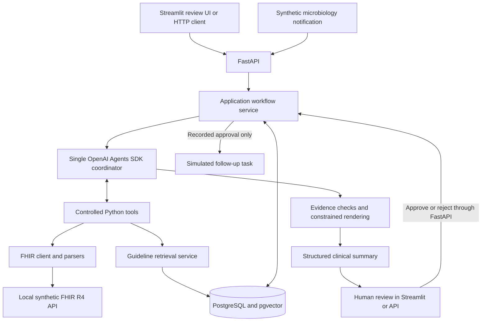

# infectious-disease-assistant

A prototype for an infectious-disease review workflow using **synthetic data
only**. A single agent gathers relevant patient context and guideline evidence,
returns a validated summary, and waits for human review before a simulated
follow-up task can be created. Never use real protected health information (PHI).
The prototype supports human review and does not provide autonomous medical advice.

## Problem and approach

A new microbiology result can require reviewing prescriptions, allergies, recent
labs, prior infections, and guidance from several sources. The relevant context
varies: an E. coli urine result with a recorded antibiotic allergy calls for a
different investigation than a no-growth result with sparse records.

An agent can choose which bounded retrieval tools to call and whether guideline
context is useful. Deterministic Python services remain the source of facts;
structured validation and a human decision control what follows. The prototype
implements this pattern with synthetic FHIR records, summaries grounded in
retrieved evidence, and simulated follow-up actions that require explicit approval.

## Architecture



Patient retrieval, FHIR parsing, guideline retrieval, and summary safety checks
are ordinary Python. SDK wrappers expose the retrieval tools; the application
service owns investigation and review state. FastAPI routes delegate to that
service, and Streamlit communicates exclusively over HTTP.
[ARCHITECTURE.md](ARCHITECTURE.md) describes the boundaries and tradeoffs.

| Technology | Role |
| --- | --- |
| Python 3.11+; Python 3.12 in Docker/CI | Application and deterministic services |
| OpenAI Agents SDK | One coordinator, function tools, native tracing |
| Pydantic | Configuration, domain models, requests, structured outputs |
| FastAPI and httpx | Application API and synthetic FHIR/HTTP clients |
| PostgreSQL and pgvector; psycopg | Workflow/audit persistence and vector retrieval |
| Streamlit | Minimal human review UI |
| pytest and Ruff | Unit/integration tests and correctness lint |
| Docker Compose and GitHub Actions | Local stack and CI |

## How tool calling works

The application binds a synthetic patient and the server-selected reviewer to
SDK context. The model sees five patient tools (`get_medications`,
`get_allergies`, `get_recent_labs`, `get_microbiology_results`,
`get_previous_infections`) plus optional `search_guidelines`.

The model requests a named function with JSON arguments. The SDK validates those
arguments, runs the corresponding Python wrapper, and returns its JSON result to
the model. Patient tools accept no model-supplied patient ID; they authorize the
bound patient before calling a domain service. Blocking retrieval runs in worker
threads. The coordinator has an eight-turn limit and no action-execution tool.

The model produces a constrained `SummaryDraft` containing selected facts,
evidence references, review topics, and a proposal flag. Python checks those
facts against retrieved records and renders a Pydantic `ClinicalSummary` with
fixed review-only language, citations, and a disclaimer. Empty or unreviewed
information is explicit. The model cannot supply free-text diagnoses, prescribing
instructions, or medication changes through this draft schema.

## Synthetic FHIR and guideline RAG

Five patients use tokens such as `PATIENT_001`. Domain services retrieve data over
HTTP from the local, read-only synthetic FHIR service, using R4 concepts including
Patient, MedicationRequest, AllergyIntolerance, Observation, DiagnosticReport,
Specimen, Condition, and Encounter. The adapter validates synthetic-only metadata,
resource types, patient references, and response shapes before mapping them into
domain models. Agent tools do not read fixture files or expose arbitrary FHIR URLs.

The knowledge base contains three CC0, project-authored synthetic review
checklists with a provenance manifest. These provide synthetic retrieval context
and are not clinical guidelines suitable for patient care.

```text
Markdown source → clean text → section-aware word chunks → embeddings
→ PostgreSQL metadata + text + pgvector embeddings
Query → embedding → cosine-distance search → text + source metadata
```

Chunk size/overlap, embedding model, and dimensions are configurable. Retrieval
filters the embedding profile, returns distance/similarity, and preserves document,
section, chunk, and license metadata. Used guideline records become summary
citations. Retrieval is optional; a nearby vector match is not proof of relevance.

## Human approval and observability

`POST /investigations` waits for the run and stores its summary as
`awaiting_review`. A reviewer reads it and uses the approve/reject endpoints.
Approval records the decision and creates any approved `create_followup_task`
inside one PostgreSQL transaction. Rejection creates no task. Row locks and unique
constraints prevent duplicate tasks; identical approval retries return the same
result. Reviewer-modified actions retain the original proposal in the audit.

PostgreSQL stores investigation/run IDs, synthetic patient tokens, timestamps,
model/configuration fingerprints, high-level tool events, summaries, decisions,
and simulated tasks. It does not copy complete FHIR resources. SDK tracing shows
model and tool activity; application logs contain event metadata rather than full
clinical payloads. Detailed synthetic trace payloads require an explicit opt-in.

## Run locally

Requires Docker with Compose v2. Clone the repository and prepare configuration:

```sh
git clone https://github.com/johnpapciak/clinical-id-assistant.git
cd clinical-id-assistant
cp .env.example .env
```

In the ignored `.env`, set a local `POSTGRES_PASSWORD`, `OPENAI_API_KEY`, and
`OPENAI_MODEL`. Then start the stack and populate guideline embeddings:

```sh
docker compose up --build -d --wait
docker compose run --rm api python -m infectious_disease_assistant.rag ingest
```

Compose starts the API, UI, synthetic FHIR server, PostgreSQL/pgvector, and a
one-shot migration service. Fixtures are bundled; migrations run automatically.
Ingestion and live investigations make paid model/embedding API calls. Without
an API key, services can start for deterministic health/FHIR checks, but live
investigations and embedding ingestion are unavailable.

| Local endpoint | Purpose |
| --- | --- |
| http://127.0.0.1:8501 | Review UI |
| http://127.0.0.1:8000/docs | Interactive FastAPI documentation |
| http://127.0.0.1:8000/health | API liveness |
| http://127.0.0.1:8765/fhir/metadata | Synthetic FHIR metadata |

Host ports are configurable in `.env`. The UI receives no model or database
credentials. The default development reviewer is assigned only `PATIENT_001`.
`IDA_CURRENT_USER_ID` and `IDA_PATIENT_ASSIGNMENTS` configure access; they are not
login or authentication.

```sh
docker compose down
```

This retains the database volume. Host Python setup, configuration, tracing,
CLI commands, API examples, and troubleshooting are in
[Development and operations](docs/DEVELOPMENT.md).

## Example workflow

1. Open the review UI, enter `PATIENT_001` and `MICRO_001_RECENT`, and click
   **Investigate**.
2. Review the structured summary, evidence/guideline sources, missing information,
   and proposed follow-up action. Status is `awaiting_review`; no task exists yet.
3. Click **Approve**, or enter a note and click **Reject**. An approved proposed
   action creates a simulated task and changes status to `approved`; rejection
   changes status to `rejected` without a task.
4. Reopen the investigation UUID or load pending reviews to inspect persisted
   state. No real EHR, prescription, or hospital workflow is modified.

The same investigation can be started through the API:

```sh
curl -X POST http://127.0.0.1:8000/investigations \
  -H 'Content-Type: application/json' \
  -d '{"patient_id":"PATIENT_001","microbiology_result_id":"MICRO_001_RECENT"}'
```

## Tests, evaluation, and CI

For local tests without Docker or provider credentials:

```sh
python3 -m venv .venv
source .venv/bin/activate
python -m pip install -e '.[dev,ui]'
python -m ruff check .
python -m pytest
python -m infectious_disease_assistant.evals.run --mode scripted --output eval-results/latest.json
```

The deterministic evaluation set has 15 clinical scenarios and five unsafe
candidates. Checks cover schema validity, fact completeness/grounding, requested
tools and arguments, citations, and human-review requirements. Reports include
latency and available SDK usage. Scripted mode exercises the actual SDK and safety
pipeline with frozen model responses, mocked FHIR HTTP, and frozen guideline
matches. It verifies pipeline behavior, not live model quality or vector ranking.
Model-judged evaluation is kept separate and is not implemented.

Unit tests require no live calls. PostgreSQL integration tests use temporary
schemas and skip unless `IDA_TEST_DATABASE_URL` points at a disposable pgvector
database. The full-stack integration test exercises Streamlit, real FastAPI/FHIR
HTTP, the SDK runner, vector retrieval, persisted review, and duplicate approval
protection, with scripted model responses and deterministic test embeddings:

```sh
python -m pytest tests/integration/test_end_to_end.py -s
```

See [the development guide](docs/DEVELOPMENT.md#tests-and-postgresql-integration)
for the test database setup. A separate opt-in `--mode live` evaluation requires
credentials and can incur API usage; it does not report a replay as a live pass.

[GitHub Actions CI](https://github.com/johnpapciak/clinical-id-assistant/actions/workflows/ci.yml)
runs lint, unit/UI tests, scripted evaluations, PostgreSQL/pgvector integration
checks, and backend/UI Docker builds on PRs and pushes to `main`. No real API keys
are configured. Tests marked `live_api` are excluded by default and from normal CI.

## Security and known limitations

This is **not HIPAA-certified or production-certified**. No real PHI is permitted.
Environment-based secrets, synthetic patient assignments, restricted tools,
parameterized SQL, safe errors, payload avoidance in logs, and approval audits
illustrate security boundaries; they do not establish compliance.
[SECURITY.md](SECURITY.md) explains deployment requirements and limitations.

The prototype scope remains focused: one agent, five fixture patients, a
limited FHIR subset without pagination, and three synthetic checklists. There is
no real authentication, background job queue, automatic recovery of interrupted
runs, or downstream hospital integration. Requests wait synchronously for a run;
investigation creation is not deduplicated, so check history before retrying a
timeout. Approval retries are protected separately. Vector retrieval uses exact
search; no large-scale ranking or clinical adequacy has been established.
Structured guardrails constrain accepted output but cannot prove that a model
selected every relevant fact or that a clinician should rely on it.

## Project summary

This prototype connects a synthetic microbiology notification to a structured
clinical summary and a human review workflow. One coordinator selects controlled
tools to retrieve patient context from a synthetic FHIR API and relevant guideline
context from PostgreSQL/pgvector. Summaries retain supporting evidence, missing
information, and proposed follow-up actions for review.

FastAPI and Streamlit provide investigation and review interfaces, while
PostgreSQL preserves workflow state and audit records. Evidence validation,
explicit approval, SDK tracing, and deterministic evaluations make the workflow
inspectable and testable. Docker Compose and CI support reproducible local runs
and automated checks. All patient data is synthetic, and downstream actions
remain simulated.
